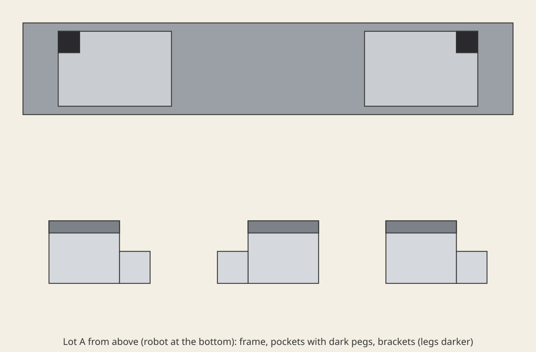

# Fit the left-hand and right-hand hinge brackets each to the pocket that takes its hand

A frame bar has two pockets, each with a small square peg in one far corner: far-left in the left pocket,
far-right in the right one. Three look-alike hinge brackets lie on the table: one left-handed and two right-handed
(mirror images). Each has a notch cut from one corner of its base, next to its upright leg. A bracket sits flat in
a pocket only when its notch is over that pocket's peg, which needs the right hand turned leg-away. Any other
bracket or turn leaves it resting on the peg, 6 mm proud and tilted. So the left pocket takes only the left-hand
bracket, and the right pocket takes either right-hand one. The instruction does not say the brackets are handed.

There are three layouts (lots, `lots.py`). Lot A (the screenshot) has the left-hand bracket at the middle tray
place. Lot B has it at the left place. Lot C has it at the right place, with every bracket turned a quarter turn. Trial
k of a run uses lot k mod 3, lot A first, so a scored run needs `--epochs 3`, and its `task_score` is the mean of
the three trials.

The task is `task.py` for the `yam_arena` embodiment of yam-isaac-lab-arena (the program's YAM embodiment for
Isaac Lab-Arena), on the `station` scene. The frame and brackets are built with `parts.py` (in this folder). It
adds multi-shape parts and step callbacks to the task-file API at import time. The lots come from `lots.py`. Both
use only NumPy and the `yam_arena` package. `near_misses.py` lists near-successes, fixed habits and wrong outcomes,
each with the score it must get.

## What the brackets look like



`brackets_top.svg` is a top-down drawing of lot A made from the geometry in `task.py` (not a render), with the robot
at the bottom. All three brackets are the same grey; only the corner the notch is cut from differs. Seen with the
leg on the far side, the middle (left-hand) bracket has its notch at the left end and the other two at the right
end. The left pocket's peg is in its far-left corner, the right pocket's in its far-right corner.

## Run a trial

From this folder, on a machine set up by the yam-isaac-lab-arena launchable:

```bash
I="Fit a hinge bracket into each of the two pockets in the frame, seated flat."

# Dream-1
inspect-robots run --embodiment yam_arena --policy dream \
  -E task=$PWD/task.py -E object_jitter=0 -E control_hz=20 -E cam_width=320 -E cam_height=176 \
  --instruction "$I" --scorer task_score --max-steps 900 --epochs 3 --store-frames --log-dir ~/yam-eval/brackets-dream

# Scripted demo
inspect-robots run --embodiment yam_arena --policy yam_scripted \
  -E task=$PWD/task.py -E object_jitter=0 -E control_hz=20 -E cam_width=640 -E cam_height=360 \
  --instruction "$I" --scorer task_score --max-steps 900 --epochs 3 --store-frames --log-dir ~/yam-eval/brackets-demo
```

`--epochs 3` runs lots A, B and C in that order. Without it only lot A runs, and there a fixed habit ("the bracket
in the middle goes in the left pocket") scores 1.0. To run one lot, put `TASK_LOT=A`, `TASK_LOT=B` or
`TASK_LOT=C` in front of the command. The videos and screenshot are from the first trial, so they show lot A.

The run prints `task_score` (the mean over the trials). Scoring is `score()` and `success()` in `task.py`; it is
described in words in `task.json`.

- **Runtime per trial:** at most 45 s of simulated time (900 steps at 20 Hz). That is about 1 to 2 minutes of wall
  time per trial on an L40S once Isaac Sim has started.
- **Seeds:** none needed. Run with `-E object_jitter=0` (as submitted), so every object starts exactly where
  `task.py` and the lot put it. With jitter on, seeded resets shift only the loose brackets.

## How it is scored (simulator details)

- **Seated in a pocket:** the bracket is upright within 2 degrees. All four corners of its base's underside (the
  full 66 x 41 mm rectangle) are within 1 mm of the pocket floor and inside the pocket's outline. No part of the
  pocket's peg is under the base: in the simulator a wrong-hand bracket cannot get there anyway, because it rests
  on the peg.
- **Released:** after every control step, both arms' gripper-body and fingertip collision hulls (the `gripper`,
  `tip_left` and `tip_right` links; not the wrist links above them) are measured against points on every bracket's surface. Released means none is within 5 mm. Offline (`near_misses.py`, no simulator) this
  is taken as met.
- **Still:** every bracket under 1 cm/s and 0.5 rad/s. The trial ends at success once that has held for 2 s.
  Otherwise the score at the last step counts.
- **Tiers:** 1.0 both pockets seated. 0.5 the left pocket seated (only the left-hand bracket fits it) and the right
  one empty. 0 otherwise. Seating a right-hand bracket in the right pocket alone earns nothing, because two of the
  three brackets fit there.
- **Habits across lots:** `near_misses.py` builds the end state of every fixed rule "the bracket at place i goes
  left, the one at place j goes right" in each lot and scores it. Each such rule averages 1/3 (1.0 in one lot, 0 in
  the other two), and the file fails to import if any rule averages more.

## Demo

`demo()` reads only the lot's starting layout (`lots.current()`: where each bracket starts and how it is turned),
never the simulator state. The left arm takes the left-hand bracket by its leg (fingers 15 mm below the leg's top,
closing across its 8 mm thickness). It carries the bracket over the left pocket, turning it leg-away where the lot
started it turned, lowers it to 5 mm above the pocket floor and lets go. It then parks. Only then does the right arm
do the same with a right-hand bracket, because in lots B and C the two arms' paths would cross. When the bracket
starts turned (lot C), the left arm aims 4.4 mm farther out and 3.8 mm to the right: in a trace, a bracket turned in the grip
lagged by that much and caught on the pocket's near wall.
