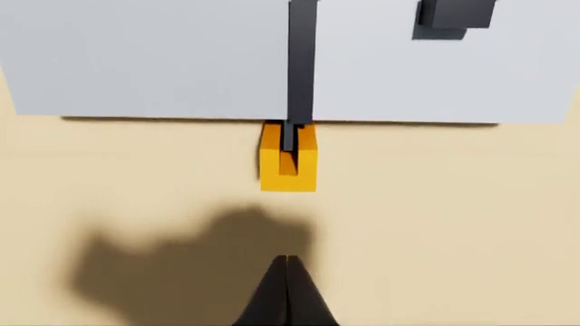

# Join two rectangular duct sections and lock the joint with a drive cleat on each side

A fixed duct section and a loose one stand on the table, the loose one 60 mm short of the joint, 25 mm to one side
and turned 8 deg. The robot is asked to join them and lock the joint with the two drive cleats. The loose section
has to be squared up and lined up, slid home under the fixed section's S-slip lip until the side flanges meet, and
then a drive cleat slid down over each pair of flanges. A cleat cannot go on first: its near cheek would stop the
loose section's flange short of the joint. A cleat dropped over a joint with a gap, or left on the flanges' tops, does
not count.

The task is `task.py` for the `yam_arena` embodiment of yam-isaac-lab-arena (the program's YAM embodiment for Isaac
Lab-Arena), on the `station` scene. It needs `parts.py` (multi-box parts) and `lots.py` (per-trial layouts), both in
this folder; it imports only NumPy and `yam_arena`. `near_misses.py` lists near-successes, wrong outcomes and fixed
habits with the score each must get; they are plain-Python checks of `score()` and `success()` and need no simulator.

## Run a trial

From this folder on a machine set up by the yam-isaac-lab-arena launchable:

```bash
I="Join the loose duct section to the fixed one and lock the joint with the two drive cleats, then let go."

# Dream-1 (both lots, averaged)
inspect-robots run --embodiment yam_arena --policy dream \
  -E task=$PWD/task.py -E object_jitter=0 -E control_hz=20 -E cam_width=320 -E cam_height=176 \
  --instruction "$I" --scorer task_score --max-steps 1200 --epochs 2 --store-frames --log-dir ~/yam-eval/duct-dream

# Scripted demo (both lots)
inspect-robots run --embodiment yam_arena --policy yam_scripted \
  -E task=$PWD/task.py -E object_jitter=0 -E control_hz=20 -E cam_width=640 -E cam_height=360 \
  --instruction "$I" --scorer task_score --max-steps 1200 --epochs 2 --store-frames --log-dir ~/yam-eval/duct-demo
```

The run prints `task_score`, the mean over trials. Scoring is `score()` and `success()` in `task.py`, described in
words in `task.json`.

- **Lots:** trial k uses lot k mod 2 (lot A first). Lot A starts the loose section 25 mm to the robot's left, turned
  8 deg; lot B mirrors it, 25 mm to the right and turned the other way. Always run with `--epochs 2` (or a multiple):
  with the default one epoch only lot A runs. `TASK_LOT=A` or `TASK_LOT=B` in the environment pins every trial to one
  lot. The videos and screenshot show the first trial, lot A.
- **Runtime per trial:** at most 60 s of simulated time (1,200 steps at 20 Hz), about 1 to 2 minutes of wall time on
  an L40S once Isaac Sim has started; the demo reaches success after about 48 s per trial.
- **Seeds:** none needed. Run with `-E object_jitter=0`: every object starts exactly where `task.py` and the lot put
  it.

## Scoring details the simulator applies

- **Home:** at each side, the loose flange's far face, taken at the middle of that flange (from the section's pose),
  between 1 mm short of and level with the fixed flanges' near face (x 0.340 m); the section's centre line within
  2 mm of y 0; its yaw and its tilt each within 1.5 deg; its lowest point within 1.5 mm of the table top. Because the
  gap is checked at both flanges, which are 135 mm apart, a section touching on one side is home only if it is
  turned under about 0.42 deg.
- **Cleat on a flange pair:** tilt within 5 deg, the slot's opening within 10 deg of facing the duct, lowest point
  within 3 mm of the table top, the 8 mm slot's two inner faces (above the 4 mm lead-in) on either side of both
  flanges' outer faces (the loose one at that side's flange), and the slot's mouth at least 5 mm inside the flanges'
  outer edge. The cleats are mirror images, so either fits either side turned round; each pair counts if either cleat
  is on it, and one cleat counts once (the better of the two assignments).
- **Released and still:** a `parts.on_step` callback reads, every control step, both arms' gripper body and finger tip
  links as convex hulls and measures their distance to every box of the section and both cleats. All three count as
  released only while every hull is more than 5 mm from all of them. Still is `ObjectState.resting()` (under 1 cm/s
  and 0.5 rad/s) for all three. Offline (near misses) there are no grippers, so released is always true there.
- **Tiers:** 1.0 home with both flange pairs cleated, 0.6 with one, 0.25 with none; each needs released and still,
  else 0.
- The trial ends with `success` once the 1.0 condition has held for 1.5 s (`SUCCESS_HOLD_S`); otherwise
  `task_score` is `score()` at the last step.
- A fixed shift or turn of the loose section joins it in one lot only, so it averages at most 0.5 for that step;
  `near_misses.py` includes lot A's moves applied in lot B (scored 0).

## The scripted demo

Fixed waypoints per lot, from the starting layout only (no object poses are read). The left arm grips the bar on the
loose section's top, lifts it 10 mm, turns it square and lines it up while carrying it to 5 mm short of the joint,
sets it down and slides it home under the lip (commanded 40 mm past contact, because the arm gives under the load,
and 2.5 to 5 mm to the robot's right, depending on the side it comes from, to allow for where the arm settles), lets go and moves aside. The right arm then
picks up the right cleat (24 mm across its cheeks), closing 3 mm past them rather than fully, carries it over the right flanges, lowers it
until the lead-in is 3 mm above them, pauses, lowers 6 mm more so the slot takes the flanges, slides it down them to
6 mm above the table and lets go by opening only 2 mm clear of the cheeks (opening fully twisted the cleat in an early
trace). It then presses the cleat to the table with its closed fingers and parks. The left arm does the same with the left cleat.
The cleat aim points are offset by 1 to 2 mm from the nominal joint to allow for where each arm leaves a held part,
measured in GPU traces.

## The joint, close up

`joint.png` is a wrist-camera frame from the final demo, looking down on a cleat on the joint: the loose section's
and the fixed section's dark flanges back to back inside the cleat's slot.



## Licences

No third-party assets: every object is built from boxes in `task.py`.
