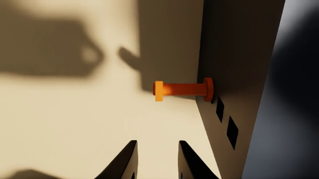

# Level a rack shelf by moving the one pull pin that is in the wrong hole

An adjustable steel rack: a shelf deck rests on four T-handle pull pins pushed through holes in two uprights. Three pins are at the middle
level; one is a hole off, so the shelf sits tilted. The robot is asked to level the shelf on all four pins. It has
to see from the tilt which pin is wrong and whether it is too low or too high, hold the shelf up off that corner
with one arm, and with the other draw the pin out by its T-handle, move it to the middle hole of the same column and
push it home, then set the shelf down. Pulled out without the shelf held up, the pin's corner drops below the middle
hole, so the pin can no longer go in under the shelf.

The task is `task.py` for the `yam_arena` embodiment of yam-isaac-lab-arena (the program's YAM embodiment for Isaac
Lab-Arena), on the `station` scene. It needs `parts.py` (multi-shape parts) and `lots.py` (layout lots), both in
this folder; they import only NumPy and `yam_arena`. `near_misses.py` lists near-successes and wrong outcomes with
the score each must get; they are plain-Python checks of `score()` and `success()` and need no simulator.

## Lots

Lot A (the screenshot): the front-left pin at level 1 (60 mm), the shelf tilted down at that corner (10.9 degrees
in the simulator). Lot B: the front-right pin at level 3 (110 mm), the shelf high at that corner (7.7 degrees).
Trial k uses lot k mod 2, lot A first, so a run needs `--epochs 2` (or a multiple); `TASK_LOT=A` or `TASK_LOT=B`
pins every trial to one lot. Offline, with the lots chosen by `lots.use()`: the habit "move the front-left pin to
level 2" scores 1.0 in lot A and 0 in lot B (the right-front pin stays high); "move the front-left pin up one
level" scores 1.0 and 0 (in lot B it moves a correct pin). Either averages 0.5: a fixed-pin habit earns half
marks over a run, as task.json's fidelity says. The lots stop a single fixed habit, not a memorised replay of both
layouts.

The top camera's screenshot shows the tilt only faintly. `fault-lot-a-wrist.png`, a frame from the left wrist camera
5 s into lot A's demo (the arm waiting over the front-left pin's handle, looking down the upright's outer face),
shows that pin in the lowest hole with the two holes above it empty; the other three pins are in their middle holes.
The tilt itself shows in the demo video as the shelf is lifted and set down level.



## Run a trial

From this folder on a machine set up by the yam-isaac-lab-arena launchable:

```bash
I="Level the shelf so it sits flat on all four of its pins."

# Dream-1, both lots
inspect-robots run --embodiment yam_arena --policy dream \
  -E task=$PWD/task.py -E object_jitter=0 -E control_hz=20 -E cam_width=320 -E cam_height=176 \
  --instruction "$I" --scorer task_score --max-steps 1200 --epochs 2 --store-frames --log-dir ~/yam-eval/shelf-dream

# Scripted demo, both lots (each reaches 1.0 in about 22 s)
inspect-robots run --embodiment yam_arena --policy yam_scripted \
  -E task=$PWD/task.py -E object_jitter=0 -E control_hz=20 -E cam_width=640 -E cam_height=360 \
  --instruction "$I" --scorer task_score --max-steps 600 --epochs 2 --store-frames --log-dir ~/yam-eval/shelf-demo
```

The run prints `task_score`, the mean over the trials. Scoring is `score()` and `success()` in `task.py`, described
in words in `task.json`.

- **Runtime per trial:** at most 60 s of simulated time (1,200 steps at 20 Hz), about 1 to 2 minutes of wall time
  on an L40S once Isaac Sim has started; a scored run is two trials.
- **Seeds:** none needed. Run with `-E object_jitter=0`: jitter would move the pins out of line with their holes.

## Scoring details the simulator applies

- "Still" means moving under 1 cm/s and turning under 0.5 rad/s (`ObjectState.resting()`); success must hold 1 s.
- **Seated:** a pin's origin is on its shank's axis at the collar's inner face. It must be within 4 mm of its
  column's x and of the upright's outer face, within 6 mm of the hole's centre height, and the shank's axis within
  10 degrees of pointing straight out of the upright. Every pin is checked against the holes of its own column.
- **Shelf level:** its body origin (the centre of the board's underside) within 4 mm of 88 mm above the table (the
  top of a seated level-2 pin), within 15 mm of x 0.30 m and of the midline, tilted at most 2 degrees.
- **Let go:** a `parts.on_step` callback reads both arms' finger, gripper and wrist (`link5`) link poses every step and measures the
  shortest distance from their collision hulls (yam_arena.analysis) to every shape of the shelf and of each pin; it
  must exceed 5 mm. Offline (`near_misses.py`) there is no robot, so this check counts as clear.
- **Fault record (whole trial):** the three correctly placed pins' positions are taken at the first step of the
  trial. If any later moves more than 8 mm in x, 5 mm in y (along its hole) or 8 mm in z, the score is 0 for the
  rest of the trial. The record is cleared by a scene reset: a `parts.on_reset` hook in the simulator, and offline
  when all four pins are back within 0.5 mm of their starts, at rest, after a jump of over 20 mm in one step.
- **0.5:** all four pins seated at level 2, the pins and the shelf at rest, let go, no fault, and the shelf's lowest
  point more than 20 mm above the table, but the shelf not level as above. The release flag and the fault record
  are both cleared by the reset hook.

## The demo

`demo()` reads the lot (which the cameras show) to pick the pin and the arms. The lifting arm, wrist turned 90
degrees, pinches the front rail on the far side of the midline and raises it 32 mm above its level height; the shelf
pivots on its back pins. The other arm pinches the wrong pin's T-handle across its flat faces (so the pin cannot turn
in the pads), draws it out 90 mm, moves it to level 2 and pushes it home against its collar, then lets go; the
lifting arm sets the shelf down and lets go. The carried pin rides 2 to 5 mm off in x and about 0.6 mm low, so the
waypoints are offset per lot (`DX`, `INSERT_DZ`), found from traces; the hole leaves 2 mm per side.

## Fidelity

A bench-scale adjustable steel rack, as used for stock and tool racking: 10 mm T-handle pull pins with a collar, in
14 mm square through-holes in 40 mm uprights, three levels 25 mm apart. The shelf deck has a front rail to lift it
by. Masses and friction (1.2) are simulator values. Pins rest 2 mm below their hole's centre and droop a few
degrees under the shelf.
