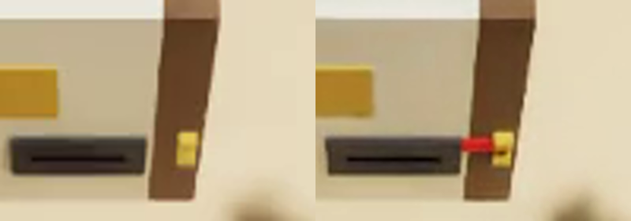

# Lock the door with its key before posting the key through the letterbox

A door section stands on the table with a sprung letterbox flap and a key-only lock below it. The key lies on a block
in front of the door. The robot is told to post the key through the letterbox and make sure the door is locked. The
lock can only be worked with the key, and a posted key falls into a closed hallway box out of reach, so the only order
that works is to lock first and post second. The instruction names posting first and does not state the order.

The task is `task.py` for the `yam_arena` embodiment of yam-isaac-lab-arena (the program's YAM embodiment for Isaac
Lab-Arena), on the `station` scene. It needs `parts.py` (multi-shape parts, joints and step hooks), in this folder;
it imports only NumPy and `yam_arena`. `near_misses.py` lists near-successes and wrong outcomes with the score each
must get; they are plain-Python checks of `score()` and `success()` and need no simulator.

## Run a trial

From this folder on a machine set up by the yam-isaac-lab-arena launchable:

```bash
I="Post the key through the letterbox, and make sure the door is locked."

# Dream-1
inspect-robots run --embodiment yam_arena --policy dream \
  -E task=$PWD/task.py -E object_jitter=0 -E control_hz=20 -E cam_width=320 -E cam_height=176 \
  --instruction "$I" --scorer task_score --max-steps 1800 --store-frames --log-dir ~/yam-eval/key-dream

# Scripted demo
inspect-robots run --embodiment yam_arena --policy yam_scripted \
  -E task=$PWD/task.py -E object_jitter=0 -E control_hz=20 -E cam_width=640 -E cam_height=360 \
  --instruction "$I" --scorer task_score --max-steps 700 --store-frames --log-dir ~/yam-eval/key-demo
```

The run prints `task_score`. Scoring is `score()` and `success()` in `task.py`, described in words in `task.json`.

- **Runtime per trial:** at most 90 s of simulated time (1,800 steps at 20 Hz), about 1 to 3 minutes of wall time on
  an L40S once Isaac Sim has started.
- **Seeds:** none needed. Run with `-E object_jitter=0`.

## How the lock works in the simulator

The door is one fixed articulation with three joints: the flap (a hinge, 0 to 1.45 rad, spring 0.005 N m/rad, damping
0.005), the bolt (a prismatic joint, 0 to 40 mm toward the robot's right, damping 1 N s/m, no spring, so it stays
where it is left) and the bolt's red tongue. The bolt bar sits hidden inside the panel below the keyway; its two dogs
stand at the back of a pocket that runs through the panel into a lock case on its inner face, 34 to 40 mm behind the
cover plate's face, with a 20 mm gap between them. A key blade (8 mm square, 50 mm long) put 40 mm into the 14 mm
keyway between the dogs pushes the bolt when the key is moved sideways; the blade has 3 mm of clearance above and below.
The tongue is what a person sees: it runs just above the keyway (92 to 104 mm up), hidden under the cover plate while
unlocked; it comes out past the cover's right end
into the keeper's jaws as the bolt is thrown. The kit's links cannot be chained, so the tongue is its own slide whose
2,000 N/m spring is set to the bolt's position every control step (it lags the bolt by under a millimetre at rest);
pushing the tongue does not move the bolt, and scoring reads the bolt.

The cover plate, panel, case and frame are fixed, so a gripper cannot reach the bolt. Finger poke: no scripted poke
was run. From the URDF collision hulls, the YAM's closed fingertips are 8 mm thick at their ends, 12 mm thick 16 mm
back and 20 mm thick 32 mm back, so even with the hand turned to point a finger into the 14 mm keyway it enters at most
about 24 mm, 10 mm short of the dogs. Pointing straight down, the hand's front reaches the cover plate before the
tips reach the keyway.

An earlier version had a sizing error in the panel piece left of the keyway (98 mm wide instead of 262 mm), which
left two slits through the door, each 82 mm long and as tall as the keyway, beside the lock that a key could have been posted through. It is fixed; the
runs below are after the fix.

`lock-state-top-camera.png` is the top camera's view of the lock, enlarged four times: on the left the first frame
(unlocked: nothing between the cover plate and the brass keeper), on the right the demo's last frame (locked: the red
tongue across the gap and into the keeper).



## Scoring details the simulator applies

- **Still:** the key under 1 cm/s and 0.5 rad/s (`ObjectState.resting()`), and the bolt moving under 0.5 mm per
  control step (1 cm/s).
- **Let go:** a `parts.on_step` callback measures the shortest distance from both arms' finger and gripper collision
  hulls (yam_arena.analysis) to the key's two boxes, the bolt's three boxes (the bar lies 4 mm behind the door face,
  so a hand resting on the door face over the bolt is not clear) and the tongue; it must exceed 5 mm. Offline
  (`near_misses.py`) there is no robot, so this counts as clear and still.
- **Locked:** the bolt joint at 35 mm or more (the tongue then fills the keeper's jaws).
- **Posted:** the key's bounding box wholly behind the panel's inner face (2 mm tolerance: the key often ends leaning
  nose-down against the inner face), in front of the box's back wall, between
  its side walls and under its roof; the flap within 0.076 rad of shut (its lower edge within 5 mm of the panel).
- **In the lock:** any part of the key's bounding box within 2 mm in front of the cover plate's outline, or behind its
  front face, inside the outline.
- **On the floor:** the key's lowest point more than 10 mm below the table top: 0.

## Scripted demo

`demo()` drives the left arm only and reads nothing from the simulator. It grips the fob's rear end from above (pads
18 mm apart across its 25 mm width, flush with its end), lifts the key to lock height, lines the blade up with the
gap between the dogs, puts it 40 mm into the keyway, slides it 50 mm to the right (the bolt stops at its 40 mm limit), draws
it out, carries it up to the letter slot and pushes it through the flap until the hand is 2 mm short of the panel. It
lets go (the key then lies across the slot floor, its centre just past the outer face), backs off, closes the fingers,
lowers them to 6 mm above the slot floor and pushes the key's end on until its centre is past the inner face; the key
tips into the hallway box and the flap shuts.

## Other ways to succeed, and what scores 0

- **Also full score:** either arm, any grip, pushing the key in with one move.
- **Score 0:** posting the key first (the door can then no longer be locked); leaving the key in the lock; dropping it
  on the floor; holding it at the end.
- **0.5:** locking the door and leaving the key anywhere else at rest, not in the lock and not on the floor.

The cases in `near_misses.py` cover the 35 mm bolt limit and the 5 mm flap limit on both sides, the key posted with the
door unlocked, left in the lock, on the table, on the slot floor, on the floor, still sliding, and just behind the
inner face.

## Recorded runs

- Earlier traces, before the review fixes: 1.0 three times (trace-20261108T055438, trace-20261108T061142,
  trace-20261108T063209). In each the key ended leaning nose-down against the panel's inner face, hence the 2 mm
  tolerance. Those runs had the panel-sizing slits described above.
- After the fixes (panel sized correctly, 14 mm keyway and 8 mm blade, red tongue): trace-20261108T093832, 1.0 (bolt
  and tongue both at 40 mm).
- Scripted demo (demo-20261108T100109): 1.0; the bolt reached its 40 mm limit and the tongue shows in the last frame.
- Dream-1, 1,800 steps (dream-20261108T100651): 0.0. It reached toward the key and moved it on its block; the door
  stayed unlocked and the key was not posted.
