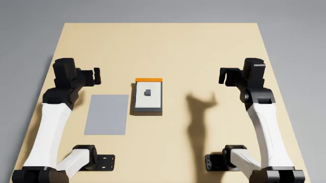
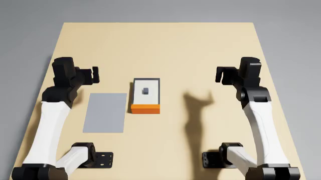

# Slide the service cover off its hidden tabs, then lift it off

A service cover lies in the top of an equipment unit. One edge of the cover runs under a lip on the unit, and two
tabs on that edge sit in slots under the lip, out of sight. Lifted straight up, the cover rises 2 mm, the tabs hit
the lip and it wedges. To take it off, the robot has to slide the cover away from the lip by at least 14 mm, then
lift it and lay it on the grey mat. The lip end of the unit is painted orange. Which edge carries it changes between trials (lots A, B and C).

| Lot A: lip far | Lot B: lip near | Lot C: lip left |
|---|---|---|
|  |  |  |

The task is `task.py` for the `yam_arena` embodiment of yam-isaac-lab-arena (the program's YAM embodiment for Isaac
Lab-Arena), run through Inspect Robots, on the `station` scene. It uses three helper files in this folder:
`parts.py` (multi-shape rigid parts), `lots.py` (layout lots) and `near_misses.py` (offline scoring checks).

## Run a trial

From this folder on a machine set up by the yam-isaac-lab-arena launchable:

```bash
I="Take the cover off the unit and lay it on the grey mat."

# Dream-1, all three lots (trial k uses lot k mod 3)
inspect-robots run --embodiment yam_arena --policy dream \
  -E task=$PWD/task.py -E object_jitter=0 -E control_hz=20 -E cam_width=320 -E cam_height=176 \
  --instruction "$I" --scorer task_score --max-steps 1200 --epochs 3 --store-frames --log-dir ~/yam-eval/cover-dream

# Scripted demo, all three lots
inspect-robots run --embodiment yam_arena --policy yam_scripted \
  -E task=$PWD/task.py -E object_jitter=0 -E control_hz=20 -E cam_width=640 -E cam_height=360 \
  --instruction "$I" --scorer task_score --max-steps 1200 --epochs 3 --store-frames --log-dir ~/yam-eval/cover-demo
```

`--epochs 3` is required: `--epochs 1` tests only lot A, where a fixed habit (always slide the cover toward the
robot) would score 1.0. Put `TASK_LOT=A`, `B` or `C` in front of the command to run every trial in one lot. The run
prints `task_score`, the mean over the trials. Scoring is `score()` and `success()` in `task.py`, described in words
in `task.json`. The videos and screenshot are the first trial's, so they show lot A.

- **Runtime per trial:** at most 60 s of simulated time (1,200 steps at 20 Hz); the demo finishes in about 17 s. A straight lift (scripted check) wedges the cover at about 10 degrees under the lip and it cannot come off.
- **Seeds:** none needed. Run with `-E object_jitter=0`; the layout is then exact in every lot.

## Scoring details for the simulator

- "Let go" is measured every step: no part of either arm's fingers or gripper body within 5 mm of any of the cover's
  shapes. "Still" is the simulator's resting test (under 1 cm/s and 0.5 rad/s), held for the 1 s success hold.
- Whether the tabs are clear is computed from the cover's true pose in the unit's frame: the far corners of both
  tabs must be at or inside the lip's inner edge.
- The unit's 3 mm / 3 degree limit is kept over the whole trial. The record is cleared only by a scene reset: the
  simulator's reset hook, or, offline, the cover and unit back within 0.5 mm of their starts and at rest after a jump
  of over 20 mm in one control step (which a robot cannot cause).
- Habits checked offline: sliding the cover toward the robot in lot B or C, or lifting it straight up in any lot,
  scores 0 (in the simulator those moves are blocked by the lip's upright, the keeper blocks or the lip itself).
- Habits checked on the GPU (scripted): a straight lift wedges the cover at about 10 degrees under the lip; a
  diagonal slide (20 mm toward the robot and 20 mm right) then a lift and carry to the mat scores 0 in each of lots
  A, B and C.

## Scripted demo

`demo()` drives the left arm: it grips the post from above, slides the cover 20 mm away from the lip (the lot's lip
edge is the one the cameras show), lifts it 100 mm, carries it over the mat, lowers it to 7 mm above the mat and lets
go. Fingers close to about 3 mm past the post's faces, across the slide direction (wrist turned -90 degrees in lot C).

## Checks without a simulator

```bash
python near_misses.py   # needs yam_arena importable
```

Cases include: slid 13 mm (0) and 14 mm (0.5), wedged under the lip (0), lifted 2 mm against the lip (0), on the mat
flat or turned (1.0), 2 mm and 3 mm above the mat (1.0, 0), on the mat's edge and 1 mm past it (1.0, 0), tilted 5
and 6 degrees (1.0, 0), upside down (0), and a unit shoved 4 mm or tipped 4 degrees (0 for the rest of the trial).

Licences: no third-party assets.
