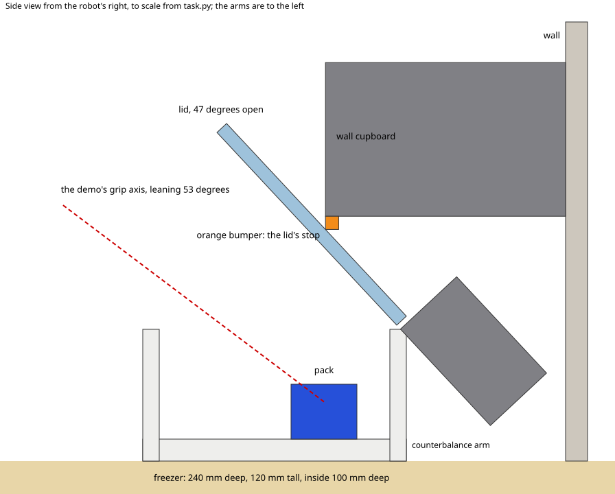

# Take a pack from the back of a chest freezer whose lid is stopped part open by a wall cupboard

A small chest freezer stands in front of a wall, under a wall cupboard. Its lid hangs on a counterbalance hinge and
swings up until it meets an orange bumper on the cupboard's lower front edge, 47 degrees open, so the lid hangs low over the back of the freezer. Two packs of the same size,
one blue and one white, stand at the back under the lid. The robot is asked to take the blue pack out and put it on
the grey mat. With the lid at 47 degrees a gripper pointing straight down cannot get its wrist under the lid to the
packs (offline, a straight-down grip at the pack puts the wrist 20 mm into the lid and the forearm 18 mm into the
cupboard; at a 35-degree lean the wrist is still 19 mm into the lid). The scripted demo leans the hand 53 degrees,
fingertips forward, enters under the lid along that line, grips the pack and backs out the same way.

The task is `task.py` for the `yam_arena` embodiment of yam-isaac-lab-arena (the program's YAM embodiment for Isaac
Lab-Arena), on the `station` scene. It needs three helper files in this folder, which import only NumPy and
`yam_arena`: `parts.py` (the freezer and its hinged lid), `lots.py` (layout lots) and `tilt.py` (the demo's leaning
grip). `near_misses.py` lists near-successes and wrong outcomes with the score each must get; they are plain-Python
checks of `score()` and `success()` and need no simulator.

## Side view

The top camera sees the lid nearly edge-on, as a pale blue band under the cupboard with the orange bumper on it.
`side_view.svg` is a to-scale side section drawn from the numbers in `task.py` (not a simulator image): the lid at
its stop, the gap over the pack, the counterbalance arm, the wall, and the demo's grip axis.



## Lots

Lot A (the screenshot): blue pack at the back left (13 cm left of the midline), white pack beside it (3 cm left).
Lot B swaps the two packs. Trial k uses lot k mod 2, lot A first, so a scored run needs `--epochs 2` (or a
multiple); `TASK_LOT=A` or `TASK_LOT=B` in the environment pins every trial to one lot. A fixed habit (always the
left pack, always the right one, always the one nearer the arm) takes the white pack in one lot and averages at most
0.5. The lots stop a single fixed habit, not a memorised replay of both layouts. Offline, with `lots.use("B")`, the
lot A answer (white pack on the mat, blue left in the freezer) scores 0.

## Run a trial

From this folder on a machine set up by the yam-isaac-lab-arena launchable:

```bash
I="Take the blue pack out of the freezer and put it on the grey mat."

# Dream-1, both lots
inspect-robots run --embodiment yam_arena --policy dream \
  -E task=$PWD/task.py -E object_jitter=0 -E control_hz=20 -E cam_width=320 -E cam_height=176 \
  --instruction "$I" --scorer task_score --max-steps 1200 --epochs 2 --store-frames --log-dir ~/yam-eval/freezer-dream

# Scripted demo, both lots (each reaches 1.0 in about 14 s)
inspect-robots run --embodiment yam_arena --policy yam_scripted \
  -E task=$PWD/task.py -E object_jitter=0 -E control_hz=20 -E cam_width=640 -E cam_height=360 \
  --instruction "$I" --scorer task_score --max-steps 600 --epochs 2 --store-frames --log-dir ~/yam-eval/freezer-demo
```

The run prints `task_score`, the mean over the trials. Scoring is `score()` and `success()` in `task.py`, described
in words in `task.json`.

- **Runtime per trial:** at most 60 s of simulated time (1,200 steps at 20 Hz), about 1 to 2 minutes of wall time
  on an L40S once Isaac Sim has started; a scored run is two trials.
- **Seeds:** none needed. Run with `-E object_jitter=0` (seeded jitter of up to 3 cm could push the packs into the freezer walls).

## Scoring details the simulator applies

- "Still" means moving under 1 cm/s and turning under 0.5 rad/s (`ObjectState.resting()`), for both packs; the
  full score must hold 1 s.
- **On the mat:** the blue pack's lowest point (world bounding box) within 1 mm of the mat's top and its centre
  within the mat's 120 mm square. Any face down counts.
- **Out of the freezer:** the pack's bounding box wholly outside the freezer's outer footprint (240 x 280 mm).
  **In the freezer:** the white pack's centre inside the inside walls and at or below the rim.
- **Let go:** a `parts.on_step` callback reads both arms' finger and gripper link poses every step and measures the
  shortest distance from their collision hulls (`yam_arena.analysis`) to the surface of each pack; it must be at
  least 5 mm for both packs. Offline (`near_misses.py`) there is no robot, so this check counts as clear.
- The lid is a hinge on the fixed freezer body (`parts.py`), written closed. The counterbalance hinge is modelled as
  a weighted arm on the lid's link behind the hinge, under the cupboard; it outweighs the lid (net lifting torque
  about 0.15 N m closed and 0.21 N m at the stop) and lifts it to the bumper (47 degrees) during the embodiment's settle at reset, before the first camera
  frame. Pressing on the lid can push it down; the cupboard stops it rising further. The lid is not scored.
- Offline checks of other approaches (collision hulls of the arm against the scene, no physics): a straight-down
  grip at the pack puts the wrist 20 mm into the lid and the forearm 27 mm into the cupboard; closed fingertips
  pressed straight down on the pack's top, to drag it forward, put the wrist 24 mm into the lid; a 35-degree lean
  still puts the wrist about 20 mm into the lid.

## The demo

`demo()` plays fixed waypoints for the left arm and reads only the lot (which place the blue pack is in, as a camera
shows it). It leans the grip 53 degrees with the fingertips forward, using `tilt.py`: a small runtime patch, in the
task's own process, of `yam_arena.demo.grip_rotation` so a waypoint can carry a tilted rotation. It affects only the
scripted demo, never Dream-1 or scoring. `python3 -c "import tilt, task; print(tilt.check_plan(task.demo()))"`
gives the plan's worst IK error offline.
