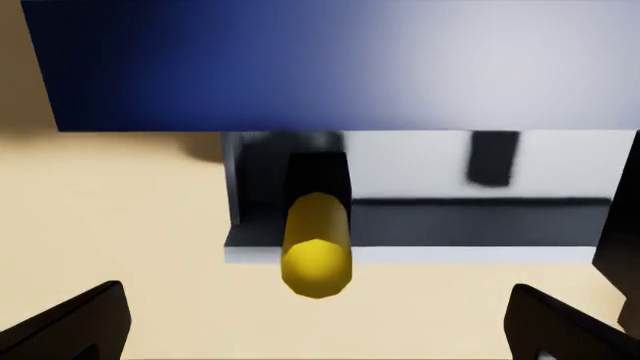

# Take the socket out of a tool chest whose drawer interlock is holding it shut

A three-drawer tool chest has a one-drawer-at-a-time interlock: while any drawer is out 5 mm or more, the other
drawers are bolted. One upper drawer stands 70 mm open because a screwdriver standing in its holder is too tall to
pass under the drawer or panel above. The robot is asked for the red socket in the bottom drawer. Pulling the bottom
drawer moves it 3 mm at most and stops. The robot has to lift the screwdriver out, shut the open drawer, and only then open the
bottom drawer. The instruction says nothing about the interlock or the screwdriver.

The task is `task.py` for the `yam_arena` embodiment of yam-isaac-lab-arena (the program's YAM embodiment for Isaac
Lab-Arena), on the `station` scene. It needs `parts.py` (multi-shape parts, joints and step hooks) and `lots.py`
(layout lots), both in this folder; they import only NumPy and `yam_arena`. `near_misses.py` lists near-successes
and wrong outcomes with the score each must get; they are plain-Python checks of `score()` and `success()` and need
no simulator.

## Lots

Lot A (the screenshot): the middle drawer is propped open by the screwdriver, whose holder is 100 mm left of the
midline. Lot B: the top drawer is, its holder 100 mm right of the midline, so the screwdriver stands 200 mm to the
right of lot A's spot. The socket is always in the bottom drawer. Trial k uses lot k mod 2, lot A first, so a scored
run needs `--epochs 2` (or a multiple); `TASK_LOT=A` or `TASK_LOT=B` in the environment pins every trial to one lot.
One fixed script cannot pass both lots: lifting at lot A's spot in lot B grips air, and pushing both upper drawers
then jams on the screwdriver. A replay of lot A's moves in lot B was traced and scored 0 (see Recorded runs). The
lots do not stop a memorised replay of both layouts.

Lots can only move loose objects, so a reset hook (`parts.on_reset`) sets the lot's drawer 70 mm open, stands the
screwdriver in its holder and puts the interlock bolts out; then `lots.py` settles the scene for 0.5 s before the
first frame. A scene reset is the only way this happens; the robot cannot trigger it.

## What the screenshot does not show

The top camera looks down, so `setup.png` shows the middle drawer standing out with the yellow handle in it, but not
why it cannot shut. `propped-drawer-wrist-view.png` is the left wrist camera's frame 2 s into the lot A demo, looking
at the chest's front: the screwdriver's yellow handle stands in front of the shut top drawer's grey front, overlapping
its lower edge, so pushing the middle drawer in drives the handle into that front.



## Run a trial

From this folder on a machine set up by the yam-isaac-lab-arena launchable:

```bash
I="Take the red socket out of the bottom drawer of the tool chest and put it on the grey mat."

# Dream-1, both lots
inspect-robots run --embodiment yam_arena --policy dream \
  -E task=$PWD/task.py -E object_jitter=0 -E control_hz=20 -E cam_width=320 -E cam_height=176 \
  --instruction "$I" --scorer task_score --max-steps 2400 --epochs 2 --store-frames --log-dir ~/yam-eval/chest-dream

# Scripted demo, both lots (each reaches 1.0 in about 35 s; the run stops at success)
inspect-robots run --embodiment yam_arena --policy yam_scripted \
  -E task=$PWD/task.py -E object_jitter=0 -E control_hz=20 -E cam_width=640 -E cam_height=360 \
  --instruction "$I" --scorer task_score --max-steps 1000 --epochs 2 --store-frames --log-dir ~/yam-eval/chest-demo
```

The run prints `task_score`, the mean over the trials. Scoring is `score()` and `success()` in `task.py`, described
in words in `task.json`.

- **Runtime per trial:** at most 120 s of simulated time (2,400 steps at 20 Hz), about 2 to 4 minutes of wall time
  on an L40S once Isaac Sim has started; a scored run is two trials.
- **Seeds:** none needed. Run with `-E object_jitter=0`.

## How the interlock works in the simulator

Each drawer is a prismatic joint (0 to 140 mm, damping 1 N s/m, no spring) with a steel lug on its right side. Each
drawer also has a bolt in the chest's right wall (a prismatic joint across the slide, 0 to 14 mm, on a stiff spring).
A `parts.on_step` hook runs every control step: a drawer is bolted when some other drawer is out 5 mm or more and this
drawer is shut to within 2.5 mm, and stays bolted until no other drawer is out 5 mm or more. While bolted, the hook
sets the drawer's slide limit to 3 mm (the clearance between its lug and bolt) and moves its bolt out in front of the
lug; otherwise the limit is the full 140 mm and the bolt is in. The slide limit is what stops a pulled drawer: in
early traces the bolt links alone did not stop it (the kit's moving links did not collide with one another), so the
bolt is now only the visible part of the mechanism. Two drawers pulled out in the same instant could both open; this
cannot happen from the start state, where one drawer is already open.

## Scoring details the simulator applies

- **Still:** the socket and screwdriver under 1 cm/s and 0.5 rad/s (`ObjectState.resting()`), and every drawer moving
  under 0.5 mm per control step (1 cm/s).
- **Let go:** the `on_step` hook measures the shortest distance from both arms' finger and gripper collision hulls
  (yam_arena.analysis) to every shape of the three drawers, the screwdriver's two cylinders (as boxes) and the socket;
  all must exceed 5 mm. Offline (`near_misses.py`) there is no robot, so this counts as clear and still.
- **On the mat:** the socket's bounding box wholly inside the mat's outline, its bottom within 1 mm of the mat's top,
  and some face within 5 degrees of straight down.
- **0.75:** the bottom drawer's joint at 100 mm or more and the socket's bottom within 1 mm of that drawer's floor,
  inside its outline as it now stands; or the socket out of the chest (not inside its front-to-back and side-to-side
  outline below the top panel), a face within 5 degrees of down, and its bottom within 1 mm of the table, the mat's top
  or the chest's top panel. So a socket over the mat's edge or dropped beside it scores 0.75, never less than a socket
  still in the drawer.
- **0.5:** the lot's propped drawer at 5 mm or less, and the screwdriver's origin (the centre of its tip) more than
  20 mm from where it stood in the holder. Laying the screwdriver flat inside that drawer and shutting it counts.
- There is no tier for the screwdriver alone: lifting it out and leaving the propped drawer open scores 0.
- **Fallen off the table:** the screwdriver's or the socket's lowest point more than 10 mm below the table top; every
  score is then 0.

## Scripted demo

`demo()` uses both arms and reads only the trial's lot (which drawer the cameras show propped open, and where its
screwdriver stands). The arm on the screwdriver's side (left in lot A, right in lot B) grips its handle from above
(fingers closing to 16 mm across the 22 mm handle), lifts it 50 mm so its tip clears the 35 mm holder, carries it
sideways past the drawer and stands it on the table beside the chest (released 7 mm up; it falls over). The right arm grips the open drawer's fin and pushes it 4 mm past shut, lets go,
grips the bottom drawer's fin and pulls it out 135 mm (it stops at about 134 mm), lets go, then lifts the socket out
of the drawer and sets it on the mat, releasing 7 mm up.

## Other ways to succeed, and what scores 0

- **Also full score:** any arm or grip; laying the screwdriver on the chest's top panel or back in a drawer; leaving the
  drawers open at the end.
- **Score 0:** pulling the bottom drawer first (it stops within 3 mm); pushing the open drawer with the screwdriver still
  in its holder (it jams on the drawer or panel above about 38 mm in; the 35 mm holder keeps the screwdriver from
  being knocked out, which a 20 mm holder did not); knocking the screwdriver or the socket off the table;
  lifting the screwdriver out but leaving its drawer open;
  holding the socket over the mat; anything still moving or held at the end.

The cases in `near_misses.py` cover the start, each bolted drawer pulled 3 mm, the jammed push, each tier, the 5 mm
shut limit and the 100 mm open limit on both sides, the mat's edge on both sides (1 mm over the edge is 0.75), the
socket on the chest's top panel, a socket held 5 mm up, a moving socket, a socket tilted on the mat's edge, the
screwdriver out with its drawer still open (0), and either part fallen off the table or the screwdriver still
standing where it was.

## Recorded runs

- Traces, `--epochs 2`: 1.0 in lot A and lot B (trace-20261108T052324 with the first interlock;
  trace-20261108T062815 with the slide-limit interlock and the 33 mm holder).
- Habit check, not for submission: lot A's demo replayed in lot B (a copy of the task whose `demo()` always uses lot
  A's moves). With the first interlock (links only, 20 mm holder) it scored 0.75 in lot B: the bolt link did not stop
  the bottom drawer, and in an earlier run the push knocked the screwdriver off the table. With the slide-limit
  interlock and the 33 mm holder it scored 0 in lot B: the push jammed the top drawer at about 30 mm with the
  screwdriver still in its holder, and the bottom drawer did not open (trace-20261108T062825).
- Scripted demo before the review fixes, `--epochs 2` (demo-20261108T065246): 1.0 in lot A and lot B.
- Scripted demo after the review fixes (holders 200 mm apart, 35 mm holder, new tiers), `--epochs 2`
  (demo-20261108T093649): 1.0 in lot A and lot B (task_score 1.0); lot B's screwdriver is taken by the right arm.
- Dream-1 before the review fixes, 2,400 steps, `--epochs 2` (dream-20261108T070917): 0.0 in both lots; both arms
  drew back and nothing was touched.
- Dream-1 after the review fixes, 2,400 steps, `--epochs 2` (dream-20261108T232904): 0.0 in both lots. The right arm
  hovered by the drawer fronts and moved nothing; the propped drawer and the screwdriver stayed as they started.
